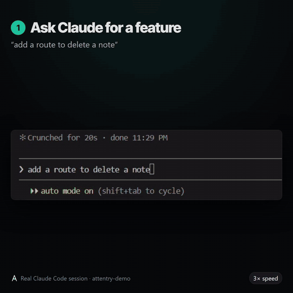

# Attentry

[](https://marketplace.visualstudio.com/items?itemName=attentry.attentry)
[](https://open-vsx.org/extension/attentry/attentry)
[](https://github.com/Aarv-1o/Attentry)
[](https://github.com/Aarv-1o/Attentry/blob/main/LICENSE)

**Your AI writes the code. Attentry checks it, without AI.**

Free and open source. It reads the code with its own rules, not another AI model, so your code
stays on your laptop and there are no tokens to pay for.

Works with **Claude Code** and **Codex**, in VS Code, Cursor and Windsurf.

## What the agent hears

Say the agent adds a route to delete shared notes, and forgets the login check. Right after that
edit, before it moves on, it gets this:

```
Attentry: this edit added 2 problems:
server/index.js:18 error attentry/unauthenticated-route: DELETE /api/shared/:id changes data, and nothing checks who's calling (other routes do)
server/index.js:18 error attentry/async-handler-no-catch: An error in this async DELETE handler isn't caught: on Express 4 one failed await can crash the whole server
Fix them before moving on, or say why not. Full steps: Attentry's explain tool with the file:line.
```

So it fixes them while the code is still fresh. A clean edit gets no message at all.



Try it on [attentry-demo](https://github.com/Aarv-1o/attentry-demo), a small notes app with
problems planted on purpose. Website: [attentry.js.org](https://attentry.js.org).

## Getting started

1. Install this extension.
2. Open the **Attentry** panel in the sidebar and connect your agent:
   - **Claude Code:** click **Connect Claude Code**. That's all.
   - **Codex:** click **Connect Codex**, then start a new Codex session and say yes when Codex asks
     whether to trust **attentry-hooks** (or type `/hooks`). You do this once: updates don't ask
     again.
3. Ask your agent for whatever you need.

Attentry is added for all your projects, and the extension keeps it up to date.

## When it speaks up

- **You send a request:** the agent is told about code in your repo that matches it, so it builds
  on what's there.
- **Before an edit:** if the agent is about to write a function the repo already has, it's told
  where the existing one is.
- **After an edit:** the problems that edit added, each one once. Old problems are left out.
- **Every 10 edits:** a short check-in with your tests, copies and unused code.
- **End of the task:** a change card with the files changed, problems added or fixed, and whether
  the tests passed.

By default Attentry only suggests. In block mode, a task can't finish while it has added a security
or crash problem (Claude Code for now; Codex in a later version).

## What it finds

- **Security:** routes, Socket.io events, tRPC procedures, GraphQL resolvers and Next.js server
  actions with no login check, no owner check or no rate limit. Secrets in the code, injection,
  XSS, CORS mistakes, weak password hashing, unverified JWTs.
- **Crash risks:** async handlers with no error handling, `JSON.parse` on outside data, handlers
  that exit the process.
- **Frontend and backend:** calls to routes that don't exist, wrong methods, routes nothing calls.
- **Database:** money stored as floats, queries inside loops, trees fetched one level at a time.
- **Copies and dead code:** exact and near copies of functions, unused files, packages and
  functions.
- **Hotspots:** complex files that change often.

## Supported backends and libraries

| What | Checked |
|---|---|
| Web frameworks | Express, Koa, Hono, Fastify, NestJS, Next.js (API routes), FastAPI, Flask, Django and Django REST Framework |
| Other ways in | Socket.io, WebSocket (`ws`), tRPC, GraphQL (Apollo Server, GraphQL Yoga, Mercurius, graphql-tools), Next.js server actions |
| Frontend calls | fetch, axios (including base URLs), apisauce, superagent, generated API clients, Vite's dev proxy |
| Databases | Mongoose, Sequelize, TypeORM, Prisma, Knex, the Django ORM, SQLAlchemy, SQLModel, raw SQL |
| Languages | JavaScript, TypeScript (including JSX and TSX), Python, Astro |

Not checked yet: hapi, restify, AdonisJS, Elysia, h3/Nitro, LoopBack, Tornado, aiohttp, Sanic,
Litestar, Django Channels, and GraphQL written with type-graphql, NestJS GraphQL, Pothos,
Graphene, Strawberry or Ariadne. If your project uses one, Attentry says it couldn't check it,
instead of reporting that everything is fine.

## In the editor

Problems in your changes are underlined. Hover to see what the code does, what can go wrong and how
to fix it; the explanations come from the code, not from AI. The light bulb can delete unused code,
copy the fix for your agent, or ignore a finding with a reason (`// attentry-ignore rule: reason`).

The panel shows what's wrong by category, whether Claude Code and Codex are connected, and how the
current task is going. **Check setup**, at the bottom, checks that everything works. In a folder of
several projects, pick one from the menu at the top (or **Attentry: Choose project**).

## Tests

Attentry runs your tests at check-ins, but only commands you've allowed, because a test script can
run anything. Connecting an agent allows the open repo's current test command. Elsewhere, or after
the command changes, click **Allow tests** in the panel.

## Privacy

Attentry runs on your machine and only reads your repo. Your code never leaves it. Its tools only
read, which is why Connect Claude Code lets Claude use them without asking each time. Codex follows
its own approval settings.

Free and open source under the MIT licence. Source on
[GitHub](https://github.com/Aarv-1o/Attentry).
